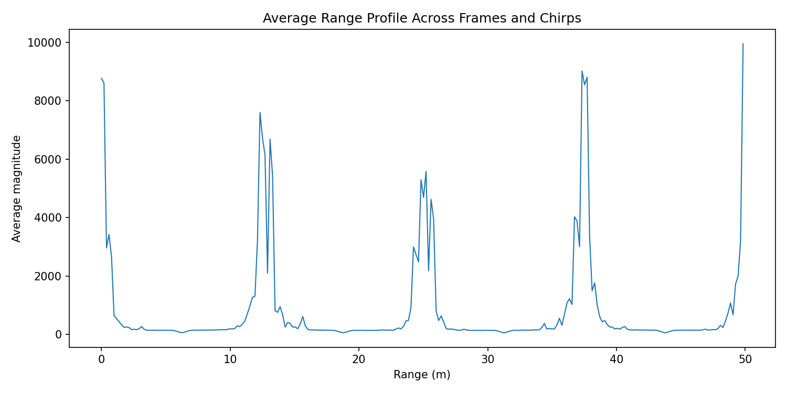

# 实测结果分析

现有采集数据已由原 Python 程序生成 13 张诊断图。采集配置和目标参考值尚未完整归档，当前检查主要针对数据排列、通道处理和坐标换算。

## 数据与程序

按代码中的每帧样本数，文件大小对应 100 帧；Python 能得到 `[100,12,128,256]` 数组，并完成后续计算。原始文件与历史中间结果的指纹保存在[来源页](../reference/sources.md)，可用于判断文件是否被修改。

这些检查说明数据量和程序执行情况。实际采集是否用了这些 TX/RX 配置、通道怎样排列，还需要采集记录或已知目标实验。

## 四个直接影响结果的问题

在检查下面的重排之前，还要先核实 I/Q 配对。TI 的标准 xWR14xx 四 lane 示例是“四 I、四 Q”，项目的两种候选都沿用“两 I、两 Q”。因此旧候选比较只覆盖了一部分格式假设，不能直接选得分高者作为 IWR1443 的正确解析。两种格式和代码见[数据解析](../data/adc-iq-layout.md)。

| 位置 | 发生了什么 | 对结果的影响 |
| --- | --- | --- |
| 数据重排 | 教程排列的距离谱约每 64 格重复；快时间连续性也较差 | 应先检查采样点与通道是否混排，后续 FFT 无法修复这个问题 |
| Doppler | `:cfg.rx` 只计算前 4 个通道 | 角度输入中的后 4 个通道为零 |
| 时间间隔 | 速度轴与跨帧时刻使用 `Tc=160 µs` | 如果实际为标准三路轮发，同一通道应使用 480 µs，速度尺度差 3 倍 |
| 跨帧频谱 | 在未采样的帧间空隙插入大量复数点 | 插值形成的谱结构可能被误认为真实运动 |

## 更换数据排列能否解决全部问题

不能。TDM 候选排列在已有检查中更连续，综合分数也更高，因此值得优先验证。但它仍需与采集配置和已知距离目标对照。即使排列正确，Doppler 通道遗漏、时间尺度、阵列位置与校准、目标选择和跨帧处理仍需分别解决。

当前主程序没有根据候选分数切换解析器，历史图片仍来自教程排列。修改报告里的名称不会改变实际计算结果。

## 角度图和微位移曲线怎样使用

角度图的横轴还是空间 FFT 格，没有验证实际阵列映射，也没有完成幅相校准和运动补偿。它可以显示当前代码产生的空间谱结构，不能直接读出可信方位。

第 30 个距离格的回波幅度很弱，通道间相干性也低。解缠相位换算出的几十毫米变化可能受噪声主导，缺少真实位移参照。[微位移测量](../processing/phase.md)说明了相位换算的条件。

<figure><figcaption>距离谱约每 64 格重复，结合快时间连续性较差的结果，应优先排查采样点与通道混排。</figcaption></figure>

## 写实验记录时怎样表述

可以写：

> 当前使用教程兼容的数据排列，距离谱出现约 64 格的周期重复。另一种 TDM 排列在连续性检查中表现更好，但缺少完整采集配置和已知目标标定，暂未将它作为正式测量依据。

若要写出具体距离、速度、角度或位移，应同时记录采用的数据排列、采样时序、校准方法、参考值和误差。下一步按[验证路线](validation-roadmap.md)逐项检查。
