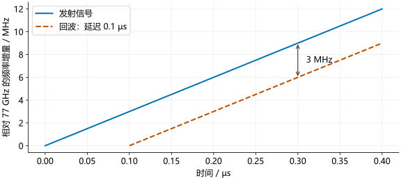

# 回波与混频

发射信号到达物体后，一部分能量反射回雷达。接收天线把回波转换为电信号。先考虑一个静止目标，并假设发射与接收天线相距很近。

## 回波延迟

目标距离为 $R$ 时，电磁波往返传播约 $2R$，所需时间为：

\[
\tau=\frac{2R}{c}.
\]

如果目标在 15 m 处，往返路程为 30 m，延迟为：

\[
\tau=\frac{30}{3\times10^8}=10^{-7}\ \mathrm{s}=0.1\ \mu\mathrm{s}.
\]

!!! formula-recap "发射波形"

    [发射信号](transmit.md)中的相位和波形为：

    \[
    \begin{aligned}
    \phi_{\mathrm{tx}}(t)&=\phi_0+2\pi\left(f_0t+\frac{St^2}{2}\right),\\
    s_{\mathrm{tx}}(t)&=A\cos\phi_{\mathrm{tx}}(t).
    \end{aligned}
    \]

    $f_0$ 为起始频率，$S$ 为扫频斜率，$\phi_0$ 为初始相位，$t$ 从这次扫频起点计时。

在时刻 $t$ 收到的回波，对应的是 $t-\tau$ 时发出的信号。因此，把发射公式中每个 $t$ 替换为 $t-\tau$，再把发射幅度 $A$ 换为接收幅度 $a$。忽略噪声和额外反射相位，得到：

\[
s_{\mathrm{rx}}(t)=a\cos\left[\phi_0+2\pi\left(f_0(t-\tau)+\frac{S(t-\tau)^2}{2}\right)\right].
\]

$a$ 表示接收到的幅度，通常远小于发射幅度。距离信息包含在时间延迟 $\tau$ 中。

## 延迟产生频率差

线性扫频时，发射频率不断上升。回波是较早发出的信号，因此在同一个接收时刻，它的频率较低：

\[
\begin{aligned}
f_{\mathrm{tx}}(t)&=f_0+St,\\
f_{\mathrm{rx}}(t)&=f_0+S(t-\tau),\\
f_{\mathrm{tx}}(t)-f_{\mathrm{rx}}(t)&=S\tau.
\end{aligned}
\]

这个频率差称为**拍频**，记作 $f_b$。代入往返延迟，得到：

\[
f_b=\frac{2SR}{c},\qquad R=\frac{cf_b}{2S}.
\]

斜率为 30 MHz/µs、距离为 15 m 时，拍频为 $30\times0.1=3$ MHz。距离增加一倍，拍频也增加一倍。

<figure><figcaption>发射信号为实线，回波为虚线。横向相差 0.1 µs，纵向相差 3 MHz。这里只画扫频开始处的一小段；回波到达前没有该目标的回波曲线。</figcaption></figure>

### 改变目标距离

拖动距离滑块。斜率保持为 30 MHz/µs，虚线的起点随往返延迟向右移动；同一时刻两条线的高度差就是拍频。图中只显示扫频开始后的 0.5 µs。

<section class="signal-lab" data-lab="echo" aria-label="距离、回波延迟与拍频演示" hidden>
  <label class="lab-range">目标距离 R：<output data-view="distance">15 m</output>
    <input type="range" min="5" max="30" step="5" value="15" aria-label="目标距离（米）" data-control="distance">
  </label>
  <p class="lab-result" data-view="result" aria-live="polite"></p>
  <div data-view="plot"></div>
  <p class="lab-legend"><span class="lab-series-a">实线：发射</span><span class="lab-series-b">虚线：回波</span><span>竖线：同一时刻的频率差</span></p>
</section>

## 混频器怎样提取拍频

本机参考信号由雷达自身提供，与发射扫频同步。混频器将它与回波相乘。记两者相位为 $\phi_{\mathrm{tx}}(t)$、$\phi_{\mathrm{rx}}(t)$，暂时省略时间参数和幅度系数，两个余弦相乘可展开为：

\[
\cos\phi_{\mathrm{tx}}\cos\phi_{\mathrm{rx}}
=\frac12\cos(\phi_{\mathrm{tx}}-\phi_{\mathrm{rx}})
+\frac12\cos(\phi_{\mathrm{tx}}+\phi_{\mathrm{rx}}).
\]

右边第一项的频率是发射与回波的频率差，第二项的频率是两者之和。例如，两路都在 77 GHz 附近、相差 3 MHz 时，差频约为 3 MHz，和频约为 154 GHz。低通滤波器让低频分量通过、衰减高频分量，因而留下用于测距的拍频信号。

对于 77 GHz 附近的雷达信号，混频后的拍频可以只有几 MHz。ADC 因而可以在较低的采样率下记录拍频，而无需直接采集 77 GHz 波形。

## 拍频信号的相位

!!! formula-recap "相减的是哪两个相位"

    \[
    \begin{aligned}
    \phi_{\mathrm{tx}}(t)&=\phi_0+2\pi(f_0t+St^2/2),\\
    \phi_{\mathrm{rx}}(t)&=\phi_0+2\pi\big[f_0(t-\tau)+S(t-\tau)^2/2\big],\\
    \phi_b(t)&=\phi_{\mathrm{tx}}(t)-\phi_{\mathrm{rx}}(t).
    \end{aligned}
    \]

    低通滤波后保留 $\cos\phi_b(t)$；静止目标的延迟 $\tau=2R/c$ 在一次扫频内保持不变。

先单独展开回波相位中的平方项：

\[
\begin{aligned}
(t-\tau)^2&=t^2-2t\tau+\tau^2,\\
f_0(t-\tau)+\frac{S(t-\tau)^2}{2}
&=f_0t-f_0\tau+\frac{St^2}{2}-St\tau+\frac{S\tau^2}{2}.
\end{aligned}
\]

用发射相位减去回波相位。相同的初始相位 $\phi_0$ 相消，括号前的减号要作用于回波展开式的每一项：

\[
\begin{aligned}
\phi_b(t)
&=2\pi\left[f_0t+\frac{St^2}{2}-f_0(t-\tau)-\frac{S(t-\tau)^2}{2}\right]\\
&=2\pi\left[f_0t+\frac{St^2}{2}-f_0t+f_0\tau-\frac{St^2}{2}+St\tau-\frac{S\tau^2}{2}\right]\\
&=2\pi\left[f_0\tau+St\tau-\frac{S\tau^2}{2}\right]\\
&=2\pi f_bt+\phi_c.
\end{aligned}
\]

其中 $f_0t$ 和 $St^2/2$ 分别抵消。对静止目标，$\tau$ 不随时间变化，所以 $f_0\tau-S\tau^2/2$ 是常数，只有 $St\tau$ 随时间变化。最后一行将常数记为 $\phi_c=2\pi(f_0\tau-S\tau^2/2)$。

相位对时间求导，再除以 $2\pi$，得到拍频：

\[
f_b=\frac{1}{2\pi}\frac{d\phi_b}{dt}
=\frac{1}{2\pi}\,2\pi S\tau
=S\tau=\frac{2SR}{c}.
\]

因此，一个静止目标在一次线性扫频内产生近似恒定频率的拍频信号。多个目标的回波叠加后，就会包含多个拍频分量。

### Python 示例

```python
c = 3e8
slope = 30e12
distance = 15.0
delay = 2 * distance / c
beat_frequency = slope * delay
recovered_distance = c * beat_frequency / (2 * slope)
print(f"延迟：{delay*1e6:.1f} us")
print(f"拍频：{beat_frequency/1e6:.1f} MHz")
print(f"距离：{recovered_distance:.1f} m")
```

### MATLAB 示例

```matlab
c = 3e8;
slope = 30e12;
distance = 15;
delay = 2*distance/c;
beatFrequency = slope*delay;
recoveredDistance = c*beatFrequency/(2*slope);
fprintf('延迟：%.1f us\n', delay*1e6);
fprintf('拍频：%.1f MHz\n', beatFrequency/1e6);
fprintf('距离：%.1f m\n', recoveredDistance);
```

结果为 0.1 µs、3.0 MHz、15.0 m。这段程序验证了延迟、拍频和距离之间的换算；实际测量中，拍频需要从采样数据估计。

这里采用“发射相位减回波相位”的约定。I/Q 接线和解调约定可以改变频率符号。运动目标还会产生多普勒频移，后面的[速度测量](../processing/doppler.md)将讨论它的影响。原理参考 [TI chirp 参数说明](https://www.ti.com/lit/an/swra553a/swra553a.pdf)。
