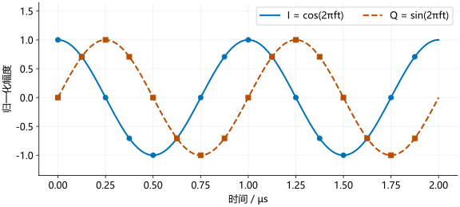

# I/Q 与采样

混频和滤波之后，接收机得到频率较低的模拟信号。ADC（模数转换器）定时测量它的电压，把连续波形转换成可以由程序处理的数值序列。

## I 和 Q

!!! formula-recap "混频后留下的相位"

    [回波与混频](echo-and-mixing.md)得到：

    \[
    \phi_b(t)=2\pi f_bt+\phi_c,\qquad f_b=\frac{2SR}{c}.
    \]

    $f_b$ 是拍频，$S$ 是扫频斜率，$R$ 是距离；$\phi_c$ 汇集了对静止目标不随时间变化的相位项。

只记录一个余弦分量，不能在单个时刻区分相反的相位：$\cos\phi=\cos(-\phi)$。正交接收机使用相差 90° 的两路参考信号进行混频，得到 I、Q 两个分量。

沿用发射相位减回波相位的约定，并选取使 Q 为正弦的正交参考方向。将接收幅度、混频与滤波增益合并记为 $A$，可写为（这里的 $A$ 是拍频幅度，不再是发射幅度）：

\[
I(t)=A\cos\phi_b(t),\qquad Q(t)=A\sin\phi_b(t).
\]

同一个接收通道在同一时刻输出 I、Q 两个电压值，分别记录余弦和正弦分量。利用欧拉公式 $e^{j\phi}=\cos\phi+j\sin\phi$，可以把它们合成一个复数：

\[
z(t)=I(t)+jQ(t)=A e^{j\phi_b(t)},\qquad j^2=-1.
\]

在复平面中，I 是横坐标，Q 是纵坐标。点到原点的距离为幅度，连线与横轴的夹角为相位：

\[
A=\sqrt{I^2+Q^2},\qquad \phi_b=\operatorname{atan2}(Q,I).
\]

例如 $I=1,Q=1$，幅度为 $\sqrt2$，相位为 45°。程序中的 `abs` 计算幅度，`angle` 计算相位。

## 定时采样

采样率 $F_s$ 表示每秒记录多少个采样点，相邻点的间隔为 $1/F_s$。如果从 $t=0$ 开始，采样时刻为：

\[
t_n=\frac{n}{F_s},\qquad n=0,1,\ldots,N_s-1.
\]

把 $t_n=n/F_s$ 代入 $z(t)=A e^{j(2\pi f_bt+\phi_c)}$：

\[
z[n]\equiv z(t_n)=A\exp\left[j\left(2\pi f_b\frac{n}{F_s}+\phi_c\right)\right].
\]

方括号表示离散编号。若 ADC 从扫频开始后的 $t_a$ 才采样，就用 $t_n=t_a+n/F_s$；对恒定拍频，多出的 $2\pi f_bt_a$ 可并入初相位。下面的短例取单位幅度、零初相位，得到：

\[
z[n]=\exp\left(j2\pi f_b\frac{n}{F_s}\right).
\]

设 $f_b=1$ MHz、$F_s=8$ MHz，则每个信号周期采 8 个点。相邻两点的相位差是 $2\pi/8=\pi/4$，即 45°。

<figure><figcaption>曲线表示理想模拟信号，圆点和方点表示 ADC 采样。两路在相同时刻采样。</figcaption></figure>

### Python 示例

```python
import numpy as np

fs = 8e6
fb = 1e6
n = np.arange(8)                 # 0 到 7
t = n / fs
z = np.exp(1j * 2*np.pi*fb*t)
print(np.round(z.real, 3))
print(np.round(z.imag, 3))
print(np.round(np.abs(z), 3))
```

### MATLAB 示例

```matlab
fs = 8e6;
fb = 1e6;
n = 0:7;
t = n/fs;
z = exp(1j*2*pi*fb*t);
disp(round(real(z),3));
disp(round(imag(z),3));
disp(round(abs(z),3));
```

I、Q 和幅度依次为：

```text
I:  1.000  0.707  0.000 -0.707 -1.000 -0.707  0.000  0.707
Q:  0.000  0.707  1.000  0.707  0.000 -0.707 -1.000 -0.707
A:  1.000  1.000  1.000  1.000  1.000  1.000  1.000  1.000
```

`1j` 是代码中的虚数单位，`np.exp` 和 `exp` 计算指数。I、Q 随时间变化，但两者合成的幅度保持为 1。

### 逐点观察 I/Q

把复数 $z[n]$ 画成从原点指向 $(I,Q)$ 的线段。相位增加时，线段旋转；它在横轴与纵轴上的投影分别给出 I 和 Q。下面仍使用 1 MHz 拍频和 8 MHz 采样率，幅度为 1。

<section class="signal-lab" data-lab="iq" aria-label="I/Q 相位与采样点演示" hidden>
  <label class="lab-range">采样点 n：<output data-view="sample">0</output>
    <input type="range" min="0" max="8" step="1" value="0" aria-label="采样点编号" data-control="sample">
  </label>
  <div class="lab-controls">
    <button type="button" data-action="previous">上一点</button>
    <button type="button" data-action="next">下一点</button>
    <button type="button" data-action="play">播放一周（慢放）</button>
    <button type="button" data-action="reset">回到起点</button>
  </div>
  <p class="lab-result" data-view="result" aria-live="polite"></p>
  <div class="lab-pair"><div data-view="circle"></div><div data-view="wave"></div></div>
  <p class="lab-legend"><span class="lab-series-a">实线 / 圆点：I</span><span class="lab-series-b">虚线 / 方点：Q</span></p>
  <p data-view="status">每次前进一个采样间隔 0.125 µs；播放仅用于慢放观察。</p>
</section>

第 2 点的相位为 90°，所以 $I=0,Q=1$；第 4 点为 180°，所以 $I=-1,Q=0$。演示额外显示第 8 点，它已经是下一周期的起点，与第 0 点数值相同。上面的代码只取一周期内的第 0～7 点。

## 量化

ADC 不能保存无限精细的电压值，而是将电压映射到有限数量的数字等级，这一步叫量化。以有符号 16 位存储为例，一个整数可表示 −32768～32767。

采样决定“什么时候测”，量化决定“用多少等级表示测量值”。电压超出 ADC 输入范围时，输出会卡在最大或最小码值，称为饱和。多个不同电压被记成同一个数，原来的高低差别已经丢失，因此后续补零或 FFT 无法恢复它们。

ADC 的量化位数和文件的存储位宽可能不同，例如较少位数的采样值也可以装在 16 位整数中。解析时须核对有效位数与符号扩展方式。整数表示 ADC 码值；换算成电压需要量程和增益，进一步换算成功率还需要阻抗及接收链标定。

## 混叠

离散采样不能区分相差整数倍采样率的复正弦频率。因为：

\[
e^{j2\pi(f+F_s)n/F_s}
=e^{j2\pi fn/F_s}e^{j2\pi n}
=e^{j2\pi fn/F_s}.
\]

例如，8 MHz 采样时，1 MHz 和 9 MHz 的复正弦给出相同的采样序列。单看这些点，程序无法判断原来是哪一个频率。采样前的模拟滤波因此要压低有效频带之外的信号，减少它们混入测量频带的机会。

复数采样常用 $[-F_s/2,F_s/2)$ 作为频率显示区间。雷达的实际有效拍频范围还受模拟滤波器和采集模式限制，应按配置确定。

IWR1443 与 IWR1843 都需要区分实数采样和复数采样模式。这里及后续示例使用复数 I/Q 数据。格式说明见 [TI ADC 数据文档](https://www.ti.com/lit/an/swra581b/swra581b.pdf)。
