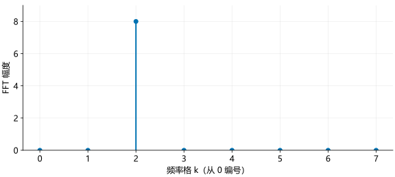

# FFT 与频谱

采样后的波形随时间变化，频谱则表示信号包含哪些频率，以及各频率分量有多强。雷达测距需要从采样序列中找到拍频，这可以用离散傅里叶变换完成。

## DFT 与 FFT

长度为 $N$ 的复数序列 $x[n]$，其离散傅里叶变换（DFT）为：

\[
X[k]=\sum_{n=0}^{N-1}x[n]e^{-j2\pi kn/N},\qquad k=0,\ldots,N-1.
\]

$n$ 是输入采样点编号，$k$ 是输出频率格编号。一个频率格也称为一个 **bin**。FFT 是快速计算 DFT 的算法，两者计算的是同一组频谱值。

公式中的指数相当于一个反向旋转的参考信号。若输入在这 $N$ 个点里恰好转了 $k$ 圈，两者相乘后就不再旋转，各点相加会得到较大的结果。频率不匹配时，乘积仍在旋转，相加时会发生抵消。

## 8 点示例

取一个在 8 点内完成 2 个周期的信号：

\[
x[n]=e^{j2\pi\cdot2n/8}.
\]

这 8 个点依次为 $1,j,-1,-j,1,j,-1,-j$。计算 $k=2$ 时：

\[
x[n]e^{-j2\pi\cdot2n/8}=1.
\]

8 个 1 相加，所以 $X[2]=8$。为什么其他整数格为零？把信号代入 DFT，并合并指数：

\[
X[k]=\sum_{n=0}^{7}e^{j2\pi(2-k)n/8}.
\]

令 $r=e^{j2\pi(2-k)/8}$，就得到等比数列 $X[k]=1+r+\cdots+r^7$。当 $k\ne2$ 时，$r\ne1$，两边乘以 $r$ 再相减：

\[
\begin{aligned}
rX[k]&=r+r^2+\cdots+r^8,\\
(1-r)X[k]&=1-r^8,\\
X[k]&=\frac{1-r^8}{1-r}.
\end{aligned}
\]

整数 $k$ 满足 $r^8=e^{j2\pi(2-k)}=1$，所以分子为零，得到 $X[k]=0$。$k=2$ 时分母也为零，不能用这个分式，必须回到 8 个 1 的直接求和。

这个推导也解释了频谱泄漏：频率不落在整数格时，$r^8$ 通常不等于 1，其他格的和就不再为零。

### Python

```python
import numpy as np

n = np.arange(8)
x = np.exp(1j * 2*np.pi*2*n/8)
X = np.fft.fft(x)
print(np.round(np.abs(X), 6))
print(np.argmax(np.abs(X)))
```

### MATLAB

```matlab
n = 0:7;
x = exp(1j*2*pi*2*n/8);
X = fft(x);
disp(round(abs(X),6));
[~, index] = max(abs(X));
k = index - 1;
disp(k);
```

频谱幅度为 `[0,0,8,0,0,0,0,0]`，峰位编号为 2。MATLAB 的第 3 个元素对应从 0 编号的第 2 格。浮点运算可能留下非常接近零的小数。

<figure><figcaption>横轴目前是频率格编号。给出采样率后，才能换算成 Hz。</figcaption></figure>

## DFT 的矩阵形式

把输入的每个采样点放进列向量，DFT 就是矩阵乘法 $\mathbf X=\mathbf F_N\mathbf x$。矩阵第 $k$ 行、第 $n$ 列是 $e^{-j2\pi kn/N}$：每一行负责一个频率格，每一列对应一个输入采样点。

以 4 点为例，$e^{-j2\pi/4}=-j$，展开各次幂可得：

\[
\begin{bmatrix}X[0]\\X[1]\\X[2]\\X[3]\end{bmatrix}
=
\underbrace{\begin{bmatrix}
1&1&1&1\\
1&-j&-1&j\\
1&-1&1&-1\\
1&j&-1&-j
\end{bmatrix}}_{\mathbf F_4}
\begin{bmatrix}x[0]\\x[1]\\x[2]\\x[3]\end{bmatrix}.
\]

例如第二行乘以输入列向量，就是 $X[1]=x[0]-jx[1]-x[2]+jx[3]$。这里的乘法不是逐元素相乘：先将同一行和输入对应位置相乘，再把四个乘积相加。

下面的图可以逐行选择频率格，查看每个乘积怎样相加。输入固定为 $\mathbf x=[1,j,-1,-j]^\mathsf T$，因此第 1 格的结果是 4，其余格为 0。

<section class="signal-lab" data-lab="dft" aria-label="四点 DFT 矩阵乘法演示" hidden>
  <label>频率格 k <select data-control="bin"><option value="0">0</option><option value="1" selected>1</option><option value="2">2</option><option value="3">3</option></select></label>
  <div data-view="matrix"></div>
  <p class="lab-result" data-view="result" aria-live="polite"></p>
</section>

### Python

```python
import numpy as np
n = np.arange(4)
k = n[:, None]
F = np.exp(-1j*2*np.pi*k*n/4)
x = np.array([1, 1j, -1, -1j])
print(np.round(F @ x, 6))
assert np.allclose(F @ x, np.fft.fft(x))
```

### MATLAB

```matlab
n = 0:3;
k = n.';
F = exp(-1j*2*pi*k*n/4);
x = [1; 1j; -1; -1j];
disp(round(F*x,6));
assert(max(abs(F*x-fft(x))) < 1e-12);
```

两种语言都得到 $[0,4,0,0]^\mathsf T$，数值误差内与 FFT 相同。显式构造 DFT 矩阵适合理解公式；数据较大时使用 FFT，不需要保存这个 $N\times N$ 矩阵。

## 频率轴

设采样率为 $F_s$，相邻频率格之间的间隔为：

\[
\Delta f=\frac{F_s}{N}.
\]

例如 $F_s=8$ MHz、$N=8$，每格对应 1 MHz，第 2 格对应 2 MHz。

对于复数信号，完整频谱包含正、负频率。以 8 点 FFT 为例：

| 数组位置（从 0 编号） | 0 | 1 | 2 | 3 | 4 | 5 | 6 | 7 |
| --- | --- | --- | --- | --- | --- | --- | --- | --- |
| 频率 / MHz | 0 | 1 | 2 | 3 | −4 | −3 | −2 | −1 |

后半段不是“更高的正频率”。`fftshift` 将负频率移到左边，零频率放在中间：

```python
fs = 8e6
frequency = np.fft.fftshift(np.fft.fftfreq(8, d=1/fs))
shifted = np.fft.fftshift(X)
print(frequency / 1e6)
```

```matlab
fs = 8e6;
frequency = (-4:3)*fs/8;
shifted = fftshift(X);
disp(frequency/1e6);
```

结果为 `[-4,-3,-2,-1,0,1,2,3]` MHz。频谱和频率轴要一起移位。

## 加窗

FFT 处理的是有限长度的数据。当信号频率不恰好落在某个频率格上时，频谱能量会分散到其他格，称为**频谱泄漏**。

窗函数把序列两端的幅度压低，可以降低远处的旁瓣，但也会让主瓣变宽。对称 Hamming 窗为：

\[
w[n]=0.54-0.46\cos\frac{2\pi n}{N-1}.
\]

Python 用 `np.hamming(N)` 生成；MATLAB 可以直接按公式计算，不需要额外工具箱：

```python
window = np.hamming(x.size)
X_windowed = np.fft.fft(x * window)
```

```matlab
N = numel(x);
window = 0.54-0.46*cos(2*pi*(0:N-1)/(N-1));
Xwindowed = fft(x.*window);
```

这里的示例是行向量。处理多维数组时，应让窗函数只沿需要加窗的维度变化。

## 补零

将 $N$ 个采样点补零后计算 $N_{\mathrm{FFT}}$ 点 FFT，会把频率格间隔变为 $F_s/N_{\mathrm{FFT}}$。例如 256 点补到 1024 点，频谱格点会密 4 倍。

补零没有延长实际观测时间，不能把原本无法分辨的两个频率真正分开。它主要用于更细致地显示或估计谱峰位置。

函数说明：[NumPy FFT](https://numpy.org/doc/stable/reference/routines.fft.html)、[MATLAB fft](https://www.mathworks.com/help/matlab/ref/fft.html)。
