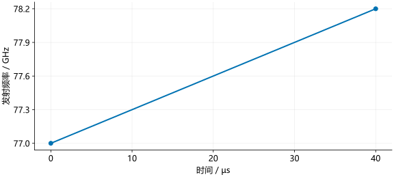

# 发射信号

雷达的发射电路产生高频电信号，天线将它辐射为电磁波。讨论信号处理时，通常用随时间变化的电压波形表示这个信号。

## 正弦信号

频率不变的信号可以写成：

\[
s(t)=A\cos(2\pi ft+\phi_0).
\]

- $A$ 是幅度，决定波形的高低。
- $f$ 是频率，单位为 Hz，表示每秒振荡多少次。
- $\phi_0$ 是初始相位，决定波形从周期中的哪个位置开始。

括号中的 $2\pi ft+\phi_0$ 称为相位，单位为弧度。相位增加 $2\pi$，波形完成一个周期。频率越高，相同时间内的周期数越多。

## 频率与波长

电磁波在空气中的传播速度近似为 $c=3\times10^8$ m/s。一个周期内传播的距离是波长：

\[
\lambda=\frac{c}{f}.
\]

77 GHz 表示每秒振荡 $77\times10^9$ 次，波长约为 3.9 mm。高频振荡发生在雷达射频电路中；后面的数据采集并不是直接以这个频率记录波形。

## 线性扫频

FMCW 雷达在一次扫频内逐渐提高频率。频率以固定速率增加时，称为**线性扫频**：

\[
f(t)=f_0+St,\qquad 0\le t<T_r.
\]

$f_0$ 是起始频率，$S$ 是扫频斜率，$T_r$ 是扫频时长。频率增加的总量称为扫频带宽：

\[
B=ST_r.
\]

例如，从 77 GHz 开始，以 30 MHz/µs 的速率上升，持续 40 µs。频率共增加 $30\times40=1200$ MHz，即 1.2 GHz，终点为 78.2 GHz。

<figure><figcaption>纵轴是频率，不是信号幅度。直线表示频率均匀上升，实际电压仍在快速振荡。</figcaption></figure>

### Python 示例

```python
import numpy as np

f0 = 77e9                  # Hz
slope = 30e12              # 30 MHz/us = 30e12 Hz/s
t = np.array([0, 10, 20, 30, 40]) * 1e-6
frequency = f0 + slope * t
print(frequency / 1e9)      # 以 GHz 显示
```

### MATLAB 示例

```matlab
f0 = 77e9;
slope = 30e12;
t = [0 10 20 30 40]*1e-6;
frequency = f0 + slope*t;
disp(frequency/1e9);
```

结果：

```text
77.0  77.3  77.6  77.9  78.2
```

`1e9` 表示 $10^9$，`1e-6` 表示 $10^{-6}$。计算时统一用 Hz 和秒，显示时再换成 GHz 和 µs。

## 扫频信号的相位

相位每增加 $2\pi$，信号振荡一次，因此：

\[
\frac{d\phi(t)}{dt}=2\pi f(t)=2\pi(f_0+St).
\]

从 0 积分到 $t$，分别积分常数项和一次项：

\[
\phi(t)=\phi_0+2\pi\left(f_0t+\frac{St^2}{2}\right).
\]

所以发射波形为：

\[
s_{\mathrm{tx}}(t)=A\cos\left[\phi_0+2\pi\left(f_0t+\frac{St^2}{2}\right)\right].
\]

频率表达式里的 $St$ 积分后是 $St^2/2$。直接把 $f_0+St$ 填进 $\cos(2\pi ft)$ 会得到错误的扫频斜率。

## 连续发射多个 chirp

一次扫频结束后，雷达按设定时序准备下一次发射。对于相同的连续 chirp，起点间隔为：

\[
T_c=T_r+T_{\mathrm{idle}}.
\]

其中 $T_{\mathrm{idle}}$ 是空闲时间。若一次扫频 40 µs、空闲 60 µs，则每 100 µs 开始一次新扫频。多个发射天线轮流工作时，还需记录每个 chirp 由哪一路天线发射；这会影响后续测速。

IWR1443 与 IWR1843 都通过配置决定起始频率、斜率、时长和发射顺序。这些数值是例题参数，不是芯片型号的固定参数。参数含义参见 [TI chirp 配置说明](https://www.ti.com/lit/an/swra553a/swra553a.pdf)。
