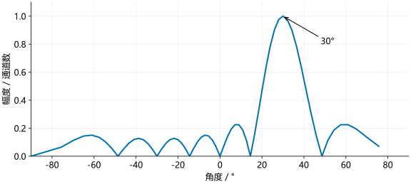

# 角度测量

目标检测给出了距离格和速度格。取出该位置各天线通道的复数值，可以根据通道间的相位差估计来波方向。

!!! formula-recap "从检测位置取出各通道"

    [多普勒 FFT](doppler.md)输出 $D[k,\ell,p]$。若检测位置为 $(k_0,\ell_0)$，则测角输入为：

    \[
    z[p]=D[k_0,\ell_0,p].
    \]

    $p$ 是通道编号。检测使用的 $\sum_p|D[k,\ell,p]|^2$ 已去掉相位，而这里需要每个通道的原始复数值。

## 天线位置与相位差

设两个接收位置间距为 $d$，目标足够远，回波可近似为平面波。角度 $\theta$ 从阵列正前方量起，两个位置的传播路程差为 $d\sin\theta$。

一个波长对应 $2\pi$ 相位，因此相邻位置的相位差大小为：

\[
\Delta\phi=\frac{2\pi d\sin\theta}{\lambda}.
\]

相位正负取决于通道编号方向和解调约定。以下使用随通道编号增加而增加的正相位模型。

这里为什么是 $2\pi/\lambda$，而测速中是 $4\pi/\lambda$？固定发射天线、比较两个接收位置时，发射到目标的路程相同，只有返回路程相差 $d\sin\theta$；目标径向移动 $\Delta R$ 时，去程和回程各改变 $\Delta R$，总变化才是 $2\Delta R$。

若 $d=\lambda/2$、$\theta=30^\circ$，由于 $\sin30^\circ=1/2$：

\[
\Delta\phi=\pi\sin30^\circ=\frac{\pi}{2}.
\]

相邻通道相差 90°。这与慢时间中的相位变化形式相似，但现在变化的是空间位置，不是观测时刻。

## 均匀线阵

$P$ 个等间距通道组成均匀线阵。第 $p$ 个通道的信号为：

\[
z[p]=A e^{j(\phi_0+2\pi p d\sin\theta/\lambda)}.
\]

相位对 $p$ 线性变化，可沿通道做 FFT。设空间 FFT 点数为 $N_a$，峰所在的有符号格编号为 $q$：

\[
\frac{q}{N_a}=\frac{d\sin\theta}{\lambda},
\qquad
\theta=\arcsin\left(\frac{\lambda q}{dN_a}\right).
\]

这一步来自空间相位与 DFT 参考相位的匹配。令 $\nu=d\sin\theta/\lambda$，它表示每增加一个通道的相位增加多少圈。补零到 $N_a$ 点后，只有原来 $P$ 个通道参与求和：

\[
\begin{aligned}
Z[q]
&=\sum_{p=0}^{P-1}A e^{j(\phi_0+2\pi p\nu)}e^{-j2\pi qp/N_a}\\
&=A e^{j\phi_0}\sum_{p=0}^{P-1}e^{j2\pi p(\nu-q/N_a)}.
\end{aligned}
\]

在 $\nu=q/N_a$ 处，各通道同相叠加。因此先解 $\sin\theta$，再取反正弦：

\[
\frac{d\sin\theta}{\lambda}=\frac{q}{N_a}
\ \Longrightarrow\
\sin\theta=\frac{\lambda q}{dN_a}
\ \Longrightarrow\
\theta=\arcsin\!\left(\frac{\lambda q}{dN_a}\right).
\]

半波长间距时，$\theta=\arcsin(2q/N_a)$。角度与 FFT 格编号不是线性关系。目标方向位于两个格之间时，最大格给出近似方向，补零只能加密这些候选格。

### Python 示例

```python
import numpy as np

p = np.arange(8)
z = np.exp(1j*np.pi*p*np.sin(np.deg2rad(30)))
na = 64
spectrum = np.fft.fftshift(np.fft.fft(z, n=na))
q = np.arange(-na//2, na//2)
index = np.argmax(np.abs(spectrum))
angle = np.degrees(np.arcsin(2*q[index]/na))
print(q[index], round(angle, 1))
```

### MATLAB 示例

```matlab
p = 0:7;
z = exp(1j*pi*p*sind(30));
na = 64;
spectrum = fftshift(fft(z,na));
q = -na/2:na/2-1;
[~, index] = max(abs(spectrum));
angle = asind(2*q(index)/na);
disp([q(index) round(angle,1)]);
```

结果为第 16 格、30°。输入只有 8 个通道，64 点 FFT 中其余位置是补零，不能据此称为 64 阵元。

<figure><figcaption>横轴由空间频率取反正弦得到，角度格点不等距。图为理想均匀线阵模拟，不是 IWR1443 或 IWR1843 开发板的实际阵列。</figcaption></figure>

## TDM 运动补偿

!!! formula-recap "时间相位与空间相位"

    [速度测量](doppler.md)给出时间差 $\delta t$ 对应的相位差 $2\pi f_D\delta t$；本页均匀线阵的空间相位为：

    \[
    \phi_{\mathrm{space},p}=\phi_0+\frac{2\pi pd\sin\theta}{\lambda}.
    \]

    $f_D$ 是目标多普勒频率。TDM 通道既有位置差，也有观测时间差，所以两种相位会同时出现。

多路 TX 轮流发射时，不同虚拟通道的观测时刻有差别。移动目标在这段时间内产生额外相位，会与空间相位叠加。

若第 $p$ 个通道比参考通道晚 $\delta t_p$，多普勒频率估计为 $\widehat f_D$，额外相位为 $2\pi\widehat f_D\delta t_p$。按正相位模型补偿：

\[
z_{\mathrm{comp}}[p]=z[p]\exp(-j2\pi\widehat f_D\delta t_p).
\]

将原来的空间相位记为 $\phi_{\mathrm{space},p}$，补偿前后的乘积展开为：

\[
\begin{aligned}
z_{\mathrm{comp}}[p]
&=A e^{j\phi_{\mathrm{space},p}}
e^{j2\pi f_D\delta t_p}
e^{-j2\pi\widehat f_D\delta t_p}\\
&=A e^{j\phi_{\mathrm{space},p}}
e^{j2\pi(f_D-\widehat f_D)\delta t_p}.
\end{aligned}
\]

估计准确时，后一个指数为 1，运动相位被抵消，空间相位保留。若多普勒估计有误差，残余相位会继续影响测角。

以下代码接在实测目标的通道提取之后：`z` 必须是该目标的 12 个虚拟通道复数值，`fd_hat`（MATLAB 中为 `fdHat`）是其多普勒频率估计，单位 Hz。它们不同于前面的 8 阵元合成例。

3 路 TX 按 160 µs 间隔轮发，每路对应 4 个 RX，且通道按 TX 分组时：

```python
offsets = np.repeat(np.arange(3)*160e-6, 4)
z_comp = z * np.exp(-1j*2*np.pi*fd_hat*offsets)
```

```matlab
offsets = repelem((0:2)'*160e-6,4);
zComp = z(:).*exp(-1j*2*pi*fdHat*offsets);
```

`offsets` 的前 4 项为 0，中间 4 项为 160 µs，最后 4 项为 320 µs。它记录同一轮内各通道相对 TX1 的观测延迟；不是同一 TX 的 480 µs 重复间隔。`fd_hat` 的正负要与解调约定一致。

## 实际阵列

IWR1443 和 IWR1843 都可以组成多个虚拟通道，但开发板上的 TX/RX 位置未必形成连续的一维半波长阵列。通常需要：

1. 根据 TX、RX 位置得到虚拟阵列坐标。在远场模型中，一组 TX/RX 对应的位置向量为两者位置向量之和。
2. 选择用于方位角的通道，并按空间位置排序。
3. 校正通道幅度与相位误差。
4. 对 TDM 移动目标补偿观测时间差。
5. 对符合均匀间距的子阵做 FFT，或按实际位置计算波束响应。

!!! formula-recap "将等间距位置换成实际位置"

    均匀线阵使用 $z[p]=Ae^{j\phi_0}e^{j2\pi pd\sin\theta/\lambda}$，其中 $pd$ 是第 $p$ 个阵元的位置。对于不等间距阵列，把 $pd$ 换成实际坐标 $r_p$ 即可；相位补偿后仍按同一位置坐标计算。

对于一维坐标 $r_p$，候选方向的导向向量为：

\[
a_p(\theta)=e^{j2\pi r_p\sin\theta/\lambda}.
\]

扫描各角度，计算：

\[
P(\theta)=\left|\sum_p a_p^*(\theta)z[p]\right|^2.
\]

$a_p^*$ 表示复共轭，即将指数中的 $j$ 换成 $-j$。若真实方向为 $\theta_0$，每一项乘积为：

\[
a_p^*(\theta)z[p]
=Ae^{j\phi_0}
\exp\left[j\frac{2\pi r_p}{\lambda}(\sin\theta_0-\sin\theta)\right].
\]

当 $\theta=\theta_0$ 时，随 $p$ 变化的相位为零，所有通道同相相加，输出较大。二维阵列还要把水平、垂直两个坐标都写入传播路程差，才能同时估计方位角和俯仰角。

参考：[TI MIMO Radar](https://www.ti.com/lit/an/swra554a/swra554a.pdf)。案例代码中的通道选择和角度轴问题见[代码分析](../code/code-map.md)。
