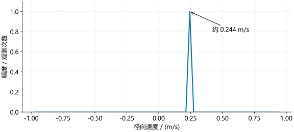

# 速度测量

距离 FFT 之后，固定一个距离格和一个通道，每次 chirp 取出该格的复数值。目标运动会使这串复数的相位随时间变化，多普勒 FFT 用于估计这种变化的频率。

这里测得的是**径向速度**：目标沿雷达与目标连线方向的速度分量，而不是任意方向的总速度。

## 位移与相位

电磁波传播一个波长 $\lambda$，相位变化 $2\pi$。目标远离雷达 $\Delta R$，往返路程增加 $2\Delta R$，因此按本教程的解调约定：

\[
\Delta\phi=2\pi\frac{2\Delta R}{\lambda}
=\frac{4\pi\Delta R}{\lambda}.
\]

若径向速度 $v$ 恒定，经过时间 $t$ 后 $\Delta R=vt$：

\[
\phi(t)=\phi_0+\frac{4\pi v}{\lambda}t
=\phi_0+2\pi f_Dt.
\]

比较两式可得多普勒频率：

\[
f_D=\frac{2v}{\lambda},\qquad v=\frac{\lambda f_D}{2}.
\]

例如波长近似为 4 mm，目标每毫秒远离 0.5 mm。往返路程每毫秒增加 1 mm，即四分之一波长，相位每次增加 $\pi/2$。4 ms 转一圈，所以 $f_D=250$ Hz，速度为 0.5 m/s。

## 慢时间采样

设同一通道的重复间隔为 $T_{\mathrm{slow}}$，第 $m$ 次观测的时刻为 $mT_{\mathrm{slow}}$。单目标信号可以写成：

\[
z[m]=A e^{j(\phi_0+2\pi f_DmT_{\mathrm{slow}})}.
\]

这与前面估计拍频的形式相同，只是采样间隔由 $1/F_s$ 换成了 $T_{\mathrm{slow}}$。

### Python 示例

```python
import numpy as np

wavelength = 3e8/77e9
tslow, nc, fd = 1e-3, 64, 125.0
m = np.arange(nc)
z = np.exp(1j*2*np.pi*fd*m*tslow)

D = np.fft.fftshift(np.fft.fft(z))
f_axis = np.fft.fftshift(np.fft.fftfreq(nc, d=tslow))
index = np.argmax(np.abs(D))
v = wavelength*f_axis[index]/2
print(f_axis[index], round(v, 3))
```

### MATLAB 示例

```matlab
wavelength = 3e8/77e9;
tslow = 1e-3; nc = 64; fd = 125;
m = 0:nc-1;
z = exp(1j*2*pi*fd*m*tslow);

D = fftshift(fft(z));
fAxis = (-nc/2:nc/2-1)/(nc*tslow);
[~, index] = max(abs(D));
v = wavelength*fAxis(index)/2;
disp([fAxis(index), round(v,3)]);
```

结果为 125 Hz、约 0.244 m/s。代码使用 77 GHz 对应的波长，不使用前面心算时近似的 4 mm。

<figure><figcaption>零速度位于中央，正负速度分列两侧。示例以远离为正；实测符号应通过已知方向的运动确认。</figcaption></figure>

## 速度轴与无模糊范围

移位后，频率格编号 $\ell$ 从 $-N_c/2$ 到 $N_c/2-1$。速度轴为：

\[
v_\ell=\frac{\lambda\ell}{2N_cT_{\mathrm{slow}}}.
\]

相邻速度格间隔为 $\lambda/(2N_cT_{\mathrm{slow}})$。慢时间采样的频率范围是 $[-1/(2T_{\mathrm{slow}}),1/(2T_{\mathrm{slow}}))$，所以速度范围为：

\[
-\frac{\lambda}{4T_{\mathrm{slow}}}
\le v<
\frac{\lambda}{4T_{\mathrm{slow}}}.
\]

增加观测次数可以细化速度格；增加重复间隔也会细化速度格，但会缩小无模糊速度范围。

## 整帧多普勒 FFT

输入 `range_cube` 的维度为 `[距离格,轮次,通道]`，沿第二维计算：

```python
nc = range_cube.shape[1]
window = np.hamming(nc).reshape(1, nc, 1)
doppler_cube = np.fft.fftshift(
    np.fft.fft(range_cube * window, axis=1), axes=1)
```

```matlab
nc = size(rangeCube,2);
window = reshape(0.54-0.46*cos(2*pi*(0:nc-1)/(nc-1)),1,[],1);
dopplerCube = fftshift(fft(rangeCube.*window,nc,2),2);
```

输出的三个维度变为距离格、速度格和通道。这里处理所有通道，不只处理第一个 TX 对应的通道。

## TDM 发射间隔

3 路 TX 轮流发射时，若相邻实际 chirp 间隔为 160 µs，则顺序为：

| 时刻 / µs | 0 | 160 | 320 | 480 |
| --- | --- | --- | --- | --- |
| 发射通道 | TX1 | TX2 | TX3 | TX1 |

TX1 每 480 µs 才重复一次，因此 $T_{\mathrm{slow}}=480$ µs。若误用 160 µs，同一个频谱峰会被换算成 3 倍速度。

IWR1443 与 IWR1843 都按实际发射时序计算这个间隔。单 TX、双 TX 轮发、三 TX 轮发以及 BPM 编码不能混用同一个时间参数。TDM 对测角相位的影响见[角度测量](angle.md)。

本章假设一帧内速度近似恒定，且目标没有明显跨越距离格。高速目标还会影响拍频，使单次扫频测距出现距离—速度耦合。推导采用相同符号时，拍频近似包含 $2SR/c+f_D$。

参考：[TI MIMO Radar](https://www.ti.com/lit/an/swra554a/swra554a.pdf)。
