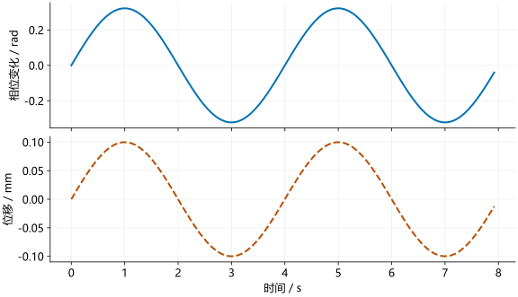

# 微位移测量

距离 FFT 用于区分目标所在的距离区域。对同一个目标持续观测时，还可以利用回波相位估计远小于距离格间隔的位移，例如振动或呼吸引起的胸廓运动。

## 相位与位移

目标位移 $\Delta R$ 引起往返路程变化 $2\Delta R$。按前面的相位约定：

\[
\Delta\phi=\frac{4\pi\Delta R}{\lambda}.
\]

移项得到：

\[
\Delta R=\frac{\lambda}{4\pi}\Delta\phi.
\]

若波长近似为 4 mm，相位变化为 $\pi/2$，则位移为：

\[
\Delta R=\frac{4}{4\pi}\times\frac{\pi}{2}=0.5\ \mathrm{mm}.
\]

这种方法测量的是同一散射目标相对于参考时刻的位移，不是通过距离 FFT 分开两个相距 0.5 mm 的目标。

## 选取目标信号

距离 FFT 之后，在目标所在的距离格、一个稳定通道上持续提取复数值：

```python
trace = range_cube[target_bin, :, channel]
```

```matlab
trace = rangeCube(targetIndex,:,channelIndex);
```

跨帧分析时，把各帧对应的复数值与真实观测时刻一起保存。若目标明显跨越距离格，需要跟踪目标，避免直接拼接不同散射区域的相位。

## 相位解缠

`angle` 返回的相位通常位于 $[-\pi,\pi]$。真实相位从 $0.9\pi$ 增长到 $1.1\pi$ 时，显示值会从 $0.9\pi$ 跳到 $-0.9\pi$。

`unwrap` 在这种跳变处补上 $2\pi$，使相位连续。但它无法区分噪声突变和真实运动。基本条件是相邻样本的真实相位增量小于 $\pi$，且信号足够强、相位可连续跟踪。

## 正弦微动示例

设目标以 0.25 Hz 的频率往复运动，位移幅度为 0.1 mm。每 80 ms 记录一次，共 100 点：

\[
d(t)=0.1\sin(2\pi\cdot0.25t)\ \mathrm{mm}.
\]

先由位移生成理想相位信号，再从信号恢复位移。

### Python

```python
import numpy as np

wavelength = 3e8/77e9
t = np.arange(100)*0.08
true_displacement = 0.1e-3*np.sin(2*np.pi*0.25*t)
z = np.exp(1j*4*np.pi*true_displacement/wavelength)

phase = np.unwrap(np.angle(z))
estimated = wavelength*(phase-phase[0])/(4*np.pi)
error = np.max(np.abs(estimated-true_displacement))
print(f"最大误差：{error*1e3:.6f} mm")
```

### MATLAB

```matlab
wavelength = 3e8/77e9;
t = (0:99)*0.08;
trueDisplacement = 0.1e-3*sin(2*pi*0.25*t);
z = exp(1j*4*pi*trueDisplacement/wavelength);

phase = unwrap(angle(z));
estimated = wavelength*(phase-phase(1))/(4*pi);
error = max(abs(estimated-trueDisplacement));
fprintf('最大误差：%.6f mm\n', error*1e3);
```

显示的最大误差为 0.000000 mm，仅余浮点误差。本例没有噪声，且初始位移为零。

<figure><figcaption>上图是相位，下图是按 λ/(4π) 换算的位移。两者只有比例关系，解缠与换算不会自动去除噪声。</figcaption></figure>

## 时间轴

一帧内部可能采样密集，两帧之间却有空闲时间。把这些观测按真实时间排列后，不一定是均匀采样序列。

如果每帧只选同一个 TX、同一个轮次的观测，则相邻点间隔为帧周期。例如帧周期为 80 ms，采样率为 12.5 Hz。只有在这些采样时刻均匀时，才能直接按该采样率计算 FFT。

把帧间空隙补成大量插值点，不会增加观测信息。频谱分析应保留真实时刻，选择合适的均匀序列或非均匀采样分析方法。

## 实测影响因素

- 目标回波过弱时，相位主要受噪声影响。
- 同一距离格内多个散射体叠加时，相位不再只对应一个物体的位移。
- 雷达自身振动、通道漂移和直流偏置也会改变相位。
- 解调符号会改变位移正负，应通过已知方向的小位移标定。

IWR1443 与 IWR1843 的换算原理相同，波长取本次工作频率，采样时刻取实际配置。案例中的弱距离格和插值问题集中在[实测结果分析](../audit/scientific-audit.md)。
