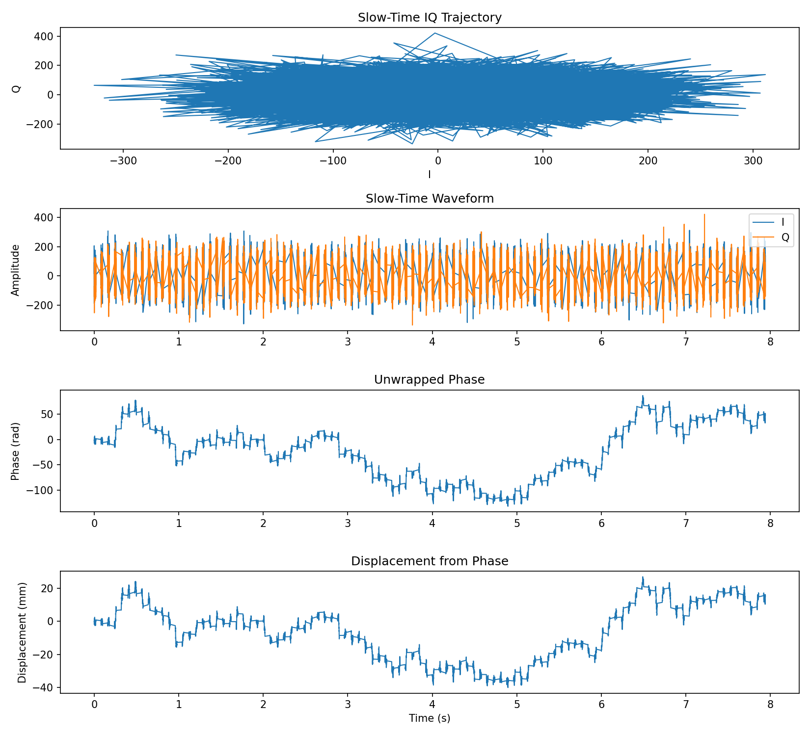

# 用相位观察微小位移

测距 FFT 的格间距约为 19.5 cm，但这并不意味着更小的运动完全看不见。只要同一个散射体持续主导某个距离格，它的复回波相位会随往返路程变化。我们可以利用这个变化观察亚毫米运动。

## 1. 为什么系数是 λ/(4π)

波走一个波长，相位改变 $2\pi$。目标移动 $\Delta R$，去程和回程合计多走 $2\Delta R$，因此：

\[
\Delta\phi=\frac{4\pi\Delta R}{\lambda},\qquad
\Delta R=\frac{\lambda}{4\pi}\Delta\phi.
\]

本项目波长约 3.851 mm，所以 1 rad 对应约 0.30646 mm。这是相对于起点的位移，不能用来直接推算目标的绝对距离。符号对应靠近还是远离仍由解调约定决定。

先用波长 4 mm 心算：相位转过四分之一圈，也就是 π/2，回波路程变化 1 mm；目标只移动其中的一半，即 0.5 mm。再换回项目的实际波长，计算方式完全相同。

!!! info "换成 IWR1843 时"
    位移公式不变。用本次射频配置的波长和真实时间戳重新计算，并检查通道相位稳定性；不能把 IWR1443 的幅相校准系数直接搬到另一块板上。

## 2. angle 与 unwrap 做了两件不同的事

`angle` 把每个复数转换成通常位于 $(-\pi,\pi]$ 范围内的相位。当连续相位从 3.1 rad 增到 3.2 rad 时，显示值会从 3.1 跳到约 −3.083。`unwrap` 通过补上 $2\pi$，尝试把这种表示造成的跳变接起来。

它并不知道目标实际怎样运动。如果信号接近零，或者两次采样之间真实相位变了很多，解缠也可能选择错误的圈数。常见充分条件是相邻真实相位变化小于 π 且噪声较小；采样空隙会让这个条件更难满足。

项目实现为：

```python linenums="338"
def compute_phase_displacement(trace: np.ndarray, cfg: RadarConfig) -> tuple[np.ndarray, np.ndarray]:
    phase = np.unwrap(np.angle(trace))
    displacement = (phase - phase[0]) * cfg.lambda_m / (4.0 * np.pi)
    return phase, displacement
```

源文件：`project/src/iwr1443_adc_utils.py`，函数 `compute_phase_displacement`。

MATLAB 等价写法：

```matlab
phi = unwrap(angle(trace));
displacement = (phi-phi(1))*wavelength/(4*pi);
```

## 3. 先用已知位移验证公式

设目标按 0.25 Hz 的频率往复运动，幅度 0.1 mm。每 80 ms 观察一次，共 100 点。下面直接生成已经选定距离格中的理想复数信号，不模拟原始 ADC 和杂波。

```python
time = np.arange(100) * 0.08
truth = 0.1e-3 * np.sin(2*np.pi*0.25*time)
trace = np.exp(1j*4*np.pi*truth/wavelength)
phi = np.unwrap(np.angle(trace))
estimated = (phi-phi[0])*wavelength/(4*np.pi)
np.testing.assert_allclose(estimated, truth, atol=1e-15)
```

```matlab
time = (0:99)*0.08;
truth = 0.1e-3*sin(2*pi*0.25*time);
trace = exp(1j*4*pi*truth/wavelength);
phi = unwrap(angle(trace));
estimated = (phi-phi(1))*wavelength/(4*pi);
assert(max(abs(estimated-truth)) < 1e-15);
```

这是验证数学和程序的一步。实际回波通常是多个散射体与噪声的复数和，不一定服从单目标模型。稳定杂波也可能让 IQ 轨迹偏离以原点为中心的圆，导致 `angle` 不再直接对应目标位移。

## 4. 实测数据先选目标，再保留真实时间

可先从能量、跨帧稳定性和场景信息选择目标距离格，并固定一个已验证通道。若帧内相位变化足够小，可对同一帧内的复数做相干平均，得到每帧一个点。若帧内转过较大相位，直接平均会相互抵消，应先补偿运动或改用恰当的代表样本。

假定距离数据按 `[帧,通道,轮次,距离格]` 保存：

```python
z = np.mean(range_cube[:, vc, :, k], axis=1)
time = np.arange(z.size) * 0.08
phi = np.unwrap(np.angle(z))
displacement = (phi-phi[0])*wavelength/(4*np.pi)
```

```matlab
z = squeeze(mean(rangeCube(:,vc,:,k),3));
time = (0:numel(z)-1)'*0.08;
phi = unwrap(angle(z));
displacement = (phi-phi(1))*wavelength/(4*pi);
```

这里的数组顺序与前面单帧 `[采样点,轮次,通道]` 不同，是跨帧处理时特意写出的约定。不要只复制 `axis` 或维数编号。

## 5. 本项目跨帧处理哪里出了问题

当前函数把每帧 128 个点放在 `frame_start + m × Tc`，再跨越帧间空隙，分别对复数实部、虚部线性插值。12800 个实测点被扩成 49628 个网格点，约 74% 是插值补出的。

```python linenums="320"
def _resample_complex_to_uniform(trace: np.ndarray, time_axis: np.ndarray, dt: float) -> tuple[np.ndarray, np.ndarray]:
    uniform_time = np.arange(time_axis[0], time_axis[-1] + dt * 0.5, dt, dtype=np.float64)
    real_uniform = np.interp(uniform_time, time_axis, trace.real)
    imag_uniform = np.interp(uniform_time, time_axis, trace.imag)
    return real_uniform + 1j * imag_uniform, uniform_time
```

源文件：`project/src/iwr1443_adc_utils.py`，函数 `_resample_complex_to_uniform`。

MATLAB 中 `interp1(time,real(z),grid,'linear') + 1j*interp1(time,imag(z),grid,'linear')` 可以实现同样操作，但同样会引入这个问题：连接两个复数点的直线，不保证符合目标在空隙中的相位运动。插值把曲线填满，不等于补回了未观测的信息。

若实际为三路轮发，帧内同一通道间隔还应使用 `3Tc`。当前 256 点 STFT 配上 160 µs 网格，频率格间距约 24.4 Hz，用它研究小于 1 Hz 的呼吸变化明显不合适。即使改成每帧一点，100 点、80 ms 间隔的记录也只有约 0.125 Hz 的频率格间距，想分辨相近的低频成分需要更长记录。

## 6. 为什么现有几十毫米曲线不可靠

<figure><figcaption>按从上到下的顺序读：先看复数信号是否稳定，再看相位是否连续，最后才看换算位移。最后一条曲线只是把前面的相位乘上比例系数，并未验证真实运动。</figcaption></figure>

第 30 格约为 5.8629 m，但它是配置指定的，不是检测器找到的目标。幅度仅约为全谱最大值的 1.076%，通道间归一化复内积的非对角中位数约 0.0388。相位解缠得到 −40.1 到 +27.0 mm 的曲线，当前证据不足以把它解释为真实位移。低相干本身也不能直接证明硬件坏了。

TDM 候选排列的第 14 格约 2.736 m，已有检查显示更稳定，适合继续验证，但稳定回波也可能来自静止物体，不代表测到了呼吸。

## 检查点

你应能解释：为什么幅值很小时不应信任相位；为什么不能先取绝对值再算相位；为什么更密的插值时间轴没有提高观测能力。下一章：[目标检测和结果验证](../practice/detection.md)。
