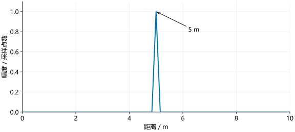

# 距离测量

对于静止目标，拍频与距离成正比：

\[
f_b=\frac{2SR}{c},\qquad R=\frac{cf_b}{2S}.
\]

实际处理中，$S$ 来自雷达配置，$f_b$ 从一次 chirp 的采样序列中估计。距离 FFT 就是沿这组采样点进行 FFT。

## 一个 5 m 目标

取斜率 $S=30$ MHz/µs、采样率 $F_s=8$ MHz、采样点数 $N_s=256$。目标距离为 5 m，则拍频为：

\[
f_b=\frac{2\times30\times10^{12}\times5}{3\times10^8}
=10^6\ \mathrm{Hz}=1\ \mathrm{MHz}.
\]

频率格间隔为 $8\text{ MHz}/256=31.25$ kHz，所以峰应出现在 $1000/31.25=32$ 格。

### Python 示例

```python
import numpy as np

c, slope, fs, ns = 3e8, 30e12, 8e6, 256
distance = 5.0
fb = 2*slope*distance/c
t = np.arange(ns)/fs
x = np.exp(1j*2*np.pi*fb*t)

X = np.fft.fft(x)
k = np.argmax(np.abs(X[:ns//2]))
estimated_frequency = k*fs/ns
estimated_range = c*estimated_frequency/(2*slope)
print(k, estimated_frequency/1e6, estimated_range)
```

### MATLAB 示例

```matlab
c = 3e8; slope = 30e12; fs = 8e6; ns = 256;
distance = 5;
fb = 2*slope*distance/c;
t = (0:ns-1)/fs;
x = exp(1j*2*pi*fb*t);

X = fft(x);
[~, index] = max(abs(X(1:ns/2)));
k = index - 1;
estimatedFrequency = k*fs/ns;
estimatedRange = c*estimatedFrequency/(2*slope);
disp([k estimatedFrequency/1e6 estimatedRange]);
```

结果为 `32, 1, 5`，分别表示第 32 格、1 MHz 和 5 m。示例将正距离设为正拍频，搜索正频率一侧；实测数据的频率符号需用已知距离目标确认。

<figure><figcaption>频谱幅度除以采样点数 256，使单位幅度信号的峰值为 1。本例无噪声且频率落在整数格上，未加窗。</figcaption></figure>

## 距离轴

若 FFT 点数为 $N_{\mathrm{FFT}}$，第 $k$ 格的频率和距离为：

\[
f_k=\frac{kF_s}{N_{\mathrm{FFT}}},\qquad
R_k=\frac{cF_s}{2SN_{\mathrm{FFT}}}k.
\]

未补零时，$N_{\mathrm{FFT}}=N_s$。本例相邻距离格为：

\[
\Delta R_{\mathrm{grid}}
=\frac{3\times10^8\times8\times10^6}{2\times30\times10^{12}\times256}
=0.15625\ \mathrm{m}.
\]

`k` 是从 0 开始的频率编号。MATLAB 数组从 1 开始，但物理坐标仍从 0 开始，不能把第一个元素标成一个距离格。

## 处理整帧

设 `frame` 按 `[采样点,轮次,通道]` 排列，距离 FFT 应只作用于第一维：

\[
X_r[k,m,p]=\sum_{n=0}^{N_s-1}x[n,m,p]w[n]e^{-j2\pi kn/N_s}.
\]

$m$ 表示轮次，$p$ 表示通道。对每个固定的 $m,p$，计算过程都与前面的单目标示例相同。

```python
ns = frame.shape[0]
window = np.hamming(ns).reshape(ns, 1, 1)
range_cube = np.fft.fft(frame * window, axis=0)
```

```matlab
ns = size(frame,1);
window = reshape(0.54-0.46*cos(2*pi*(0:ns-1)/(ns-1)),[],1,1);
rangeCube = fft(frame.*window,ns,1);
```

窗的尺寸为 `[采样点,1,1]`，因此会对每个轮次和通道使用相同的窗。输出尺寸不变，但第一维已从时间采样点变成距离格。`range_cube` 必须保留复数值，后续测速和测角还需要相位。

## 距离分辨率

采样时间为 $T_{\mathrm{ADC}}=N_s/F_s$，覆盖带宽为 $B_{\mathrm{ADC}}=ST_{\mathrm{ADC}}$。代入后，未补零的距离格间隔可写为：

\[
\Delta R_{\mathrm{grid}}=\frac{c}{2B_{\mathrm{ADC}}}.
\]

这也是矩形窗下常用的理想距离分辨尺度。本例有效带宽为 960 MHz，因此得到 0.15625 m。加窗会改变主瓣宽度，实际分开两个目标的能力还与信噪比和目标强弱有关。

单个目标的距离可以用峰值插值估得更细，但“更精确地估计一个峰”与“分开两个峰”是两个问题。

IWR1443 和 IWR1843 使用同一换算公式，应分别代入实际采样率、斜率和点数。案例中的原参数及代码见[参数对照](../orientation/parameters-and-shapes.md)与[代码分析](../code/code-map.md)。

理论依据：[TI chirp 参数说明](https://www.ti.com/lit/an/swra553a/swra553a.pdf)。
