# 诊断图说明

这些图片来自项目原有的 `strict_matlab` 处理结果。图中幅度没有完成物理功率标定，单位只用于相同设置下的数值比较。

## 1. 原始采样值

<figure>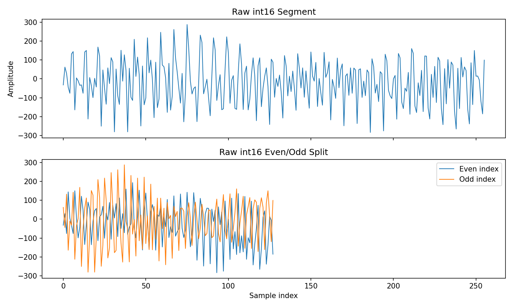<figcaption>横轴是整数在文件中的编号，纵轴是原始数值。数值长期停在量程端点可能表示饱和，连续零值可能提示采集异常；下半图只是奇偶位置拆分，不是 I/Q。</figcaption></figure>

[回到原理与代码](../data/adc-iq-layout.md)。

## 2. 单次扫频的 I/Q

<figure>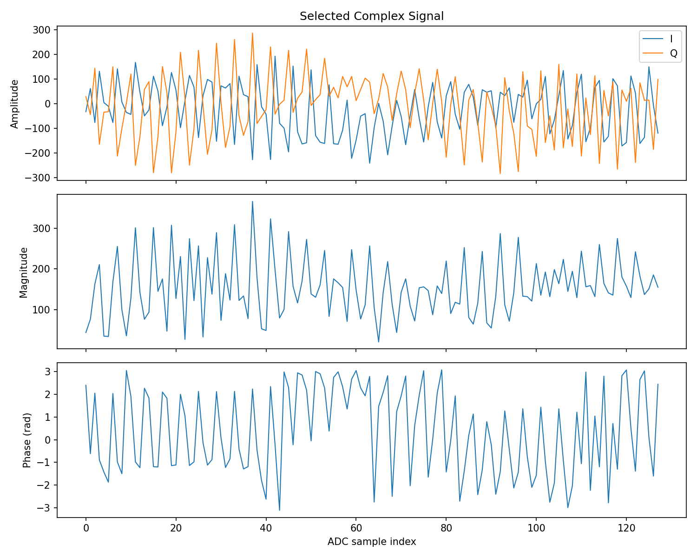<figcaption>横轴沿同一次扫频的采样点变化。I、Q 显示采样值随时间的变化；幅度接近零时，相位通常受噪声主导。这里沿用原程序的四整数配对。</figcaption></figure>

[回到原理与代码](../data/adc-iq-layout.md)。

## 3. I/Q 散点

<figure>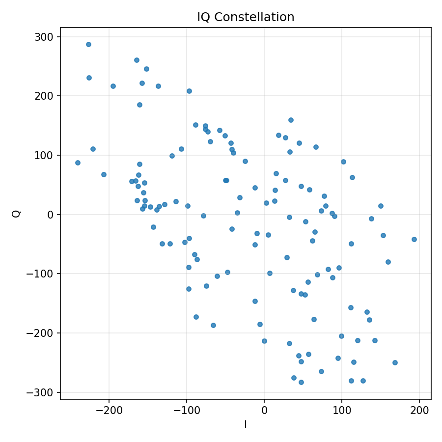<figcaption>横轴 I、纵轴 Q，每个点是一对采样值。它可以显示中心偏移和幅度分布，但点的时间顺序已经丢失。不能仅凭散点像圆就认定相位测量正确。</figcaption></figure>

[回到原理与代码](../foundations/signal-and-fft.md)。

## 4. 单次距离谱

<figure>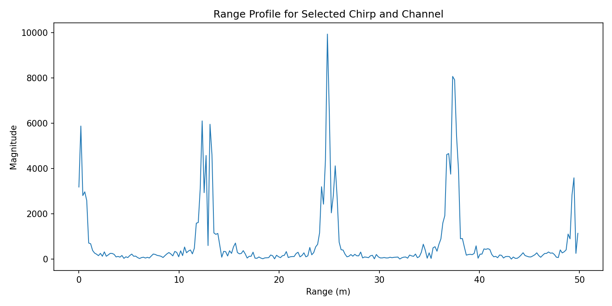<figcaption>横轴是代码换算出的距离，纵轴是未标定的 FFT 幅度。峰的位置对应较强的频率分量；完整 FFT 的后半段不能直接当作更远距离。</figcaption></figure>

[回到原理与代码](../processing/range.md)。

## 5. 平均距离谱

<figure><figcaption>这是跨轮次和帧的幅度平均。相邻重复峰约相隔 64 格。重复峰可能由数据排列错误产生，跨帧平均不会消除这种系统性结构。</figcaption></figure>

[回到原理与代码](../processing/range.md)。

## 6. 距离—时间图

<figure>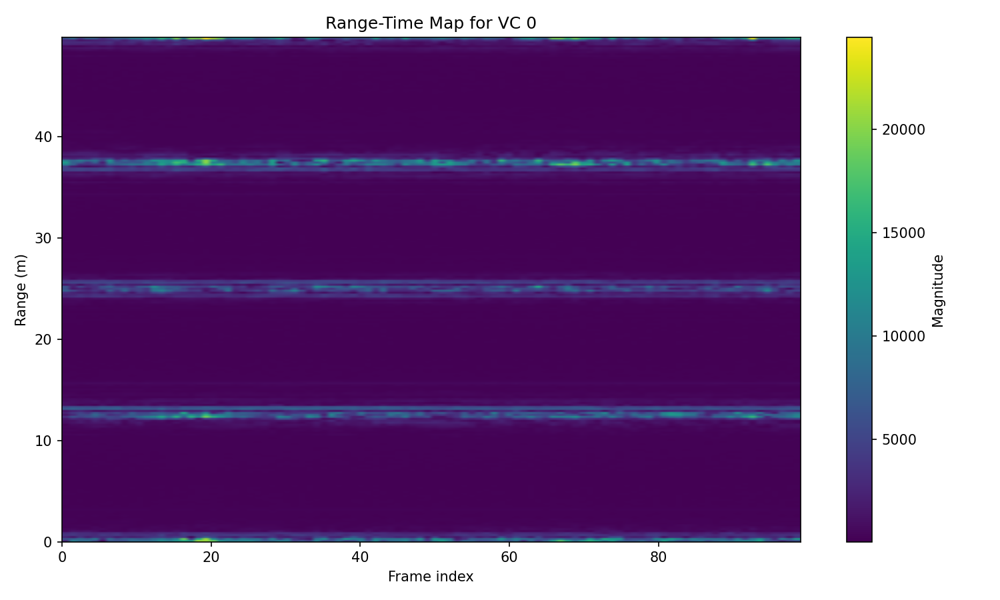<figcaption>横轴是帧编号，另一轴是距离，颜色表示每帧的平均幅度。水平条纹说明某个距离格长期较强，但可能是稳定背景或重复伪影；这张图没有目标关联和跟踪。</figcaption></figure>

[回到原理与代码](../audit/scientific-audit.md)。

## 7. 相位与位移

<figure><figcaption>三幅子图分别为 I/Q、相位与位移。位移由相位变化乘以 λ/(4π) 得到。第 30 格信号较弱，噪声引起的相位变化也会被换算成位移，因此图中的几十毫米变化尚不能归因于目标运动。</figcaption></figure>

[回到原理与代码](../processing/phase.md)。

## 8. 跨帧频谱

<figure>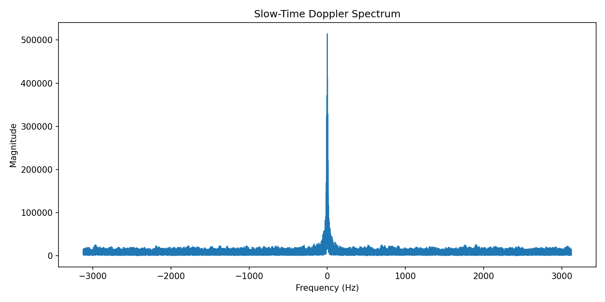<figcaption>横轴是按 160 µs 插值网格得到的频率，纵轴是频谱幅度。约 74% 的点由帧间插值补出，因此不要把这些峰当成标准单帧 Doppler 结果。</figcaption></figure>

[回到原理与代码](../processing/phase.md)。

## 9. 时频图

<figure>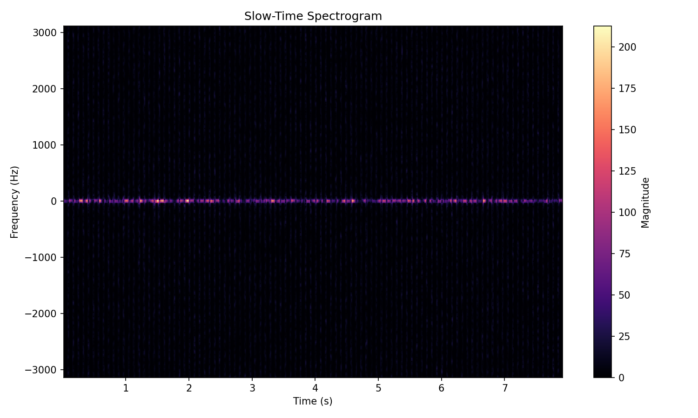<figcaption>一个方向是时间，另一个是频率，颜色表示短时频谱强弱。周期竖条可能与帧间空隙和插值有关；约 24.4 Hz 的频率格间距不足以研究亚赫兹运动。</figcaption></figure>

[回到原理与代码](../processing/phase.md)。

## 10. 十二通道 I/Q

<figure>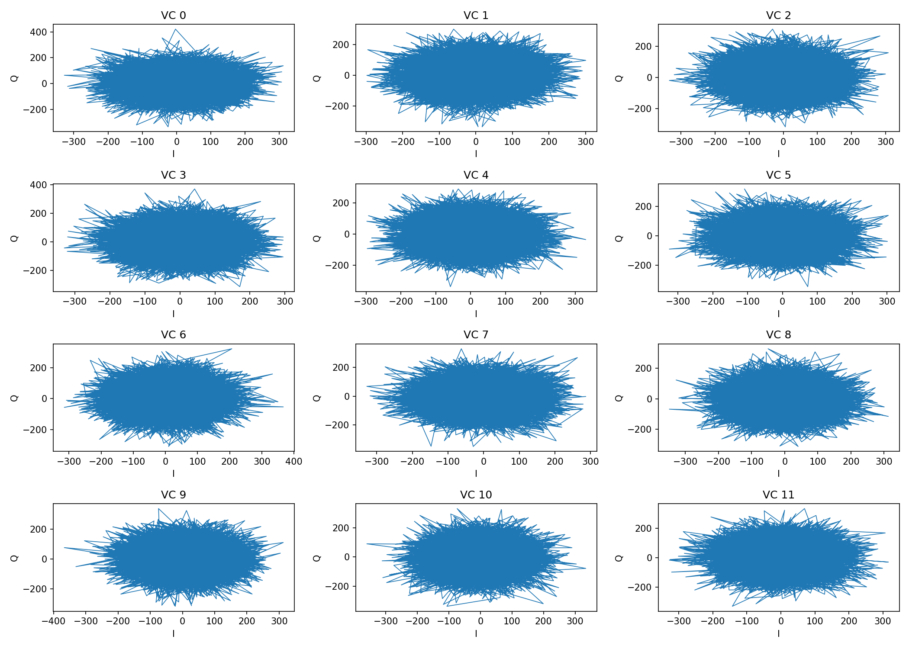<figcaption>每个小图对应一个通道的 I/Q 轨迹。各图坐标范围不同，自动缩放会让不同幅度看起来相似；跨帧连线也不能当作空隙内真实轨迹。</figcaption></figure>

[回到原理与代码](../processing/phase.md)。

## 11. 十二通道相位

<figure>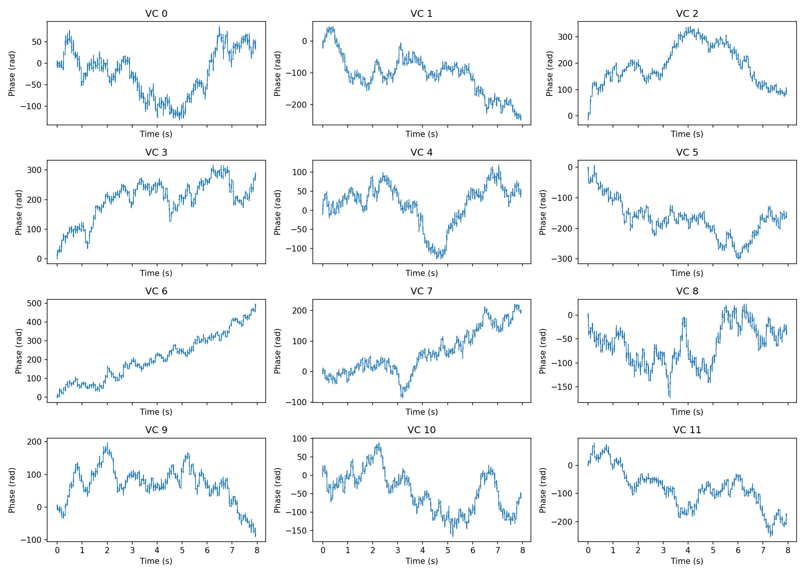<figcaption>每个小图显示同一距离格的通道相位。曲线高低受通道相位偏置和解缠圈数影响。比较通道时，需要结合幅度判断信号强弱，并比较相位随时间的变化。</figcaption></figure>

[回到原理与代码](../processing/phase.md)。

## 12. 通道相干矩阵

<figure>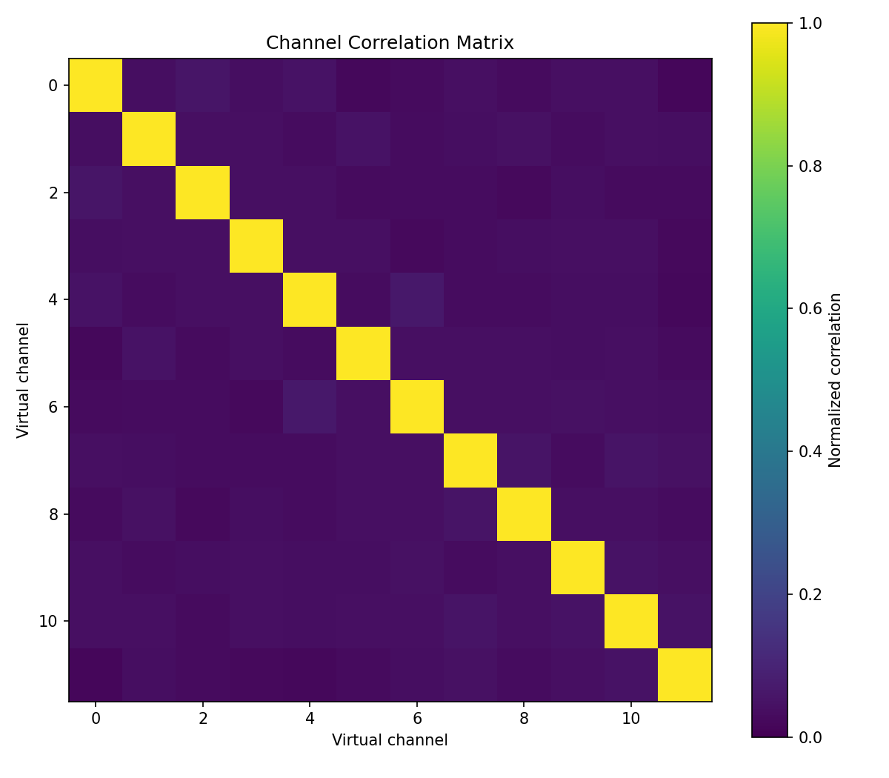<figcaption>横纵轴都是通道编号，数值越接近 1，表示两个复数序列的归一化内积模越大。当前非零序列与自身比较为 1；低非对角值可能来自噪声、排列错误或相位变化，不能单独定位原因。</figcaption></figure>

[回到原理与代码](../code/code-map.md)。

## 13. 距离—空间频率图

<figure>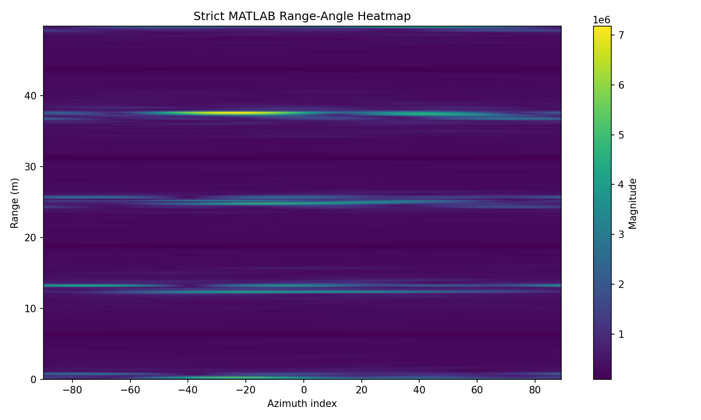<figcaption>横轴是空间 FFT 格，纵轴是代码换算出的距离，颜色来自对 Doppler 维的幅度求和。输入仅 4 个通道有效，另 4 个为零；阵列和角度轴尚未校准。</figcaption></figure>

[回到原理与代码](../processing/angle.md)。

## 绘图示例

以单轮距离谱为例，下面假定已经有距离轴和距离 FFT 数组：

```python
import matplotlib.pyplot as plt
plt.plot(range_axis[:128], np.abs(range_profile[:128,0,0]))
plt.xlabel('Range (m)')
plt.ylabel('FFT magnitude (a.u.)')
plt.grid(True)
plt.show()
```

```matlab
plot(rangeAxis(1:128),abs(rangeCube(1:128,1,1)));
xlabel('Range (m)'); ylabel('FFT magnitude (a.u.)'); grid on;
```

同时写下选了哪一帧、哪一轮、哪个通道，用了什么窗和哪种数据排列。比较两种算法时保持横纵轴范围一致，否则自动缩放容易造成误判。
